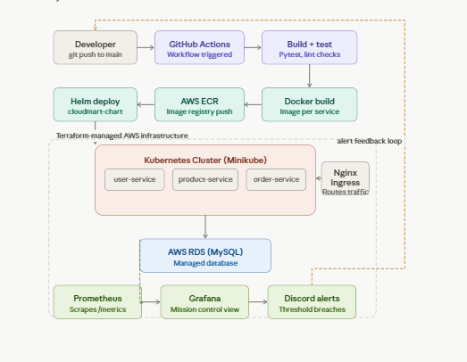
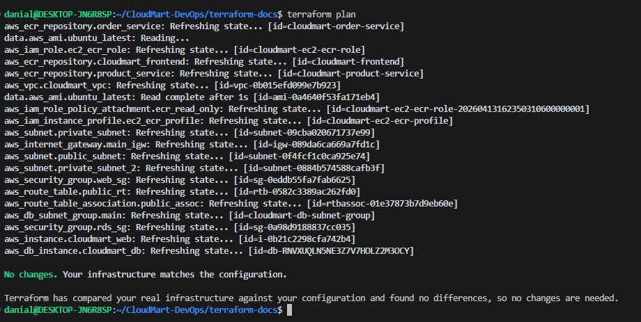
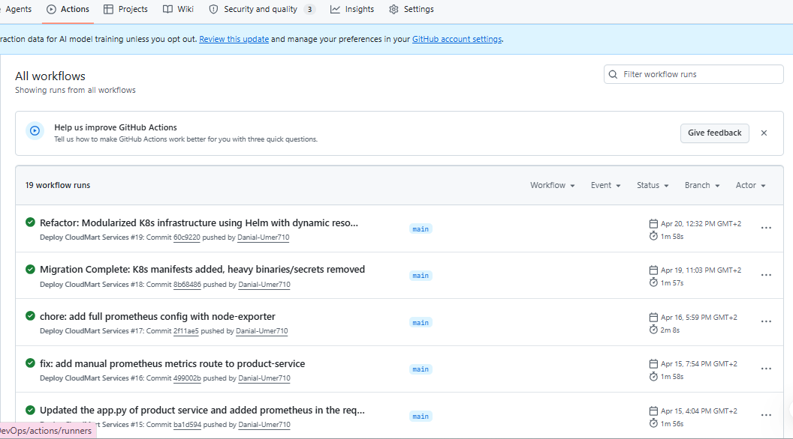
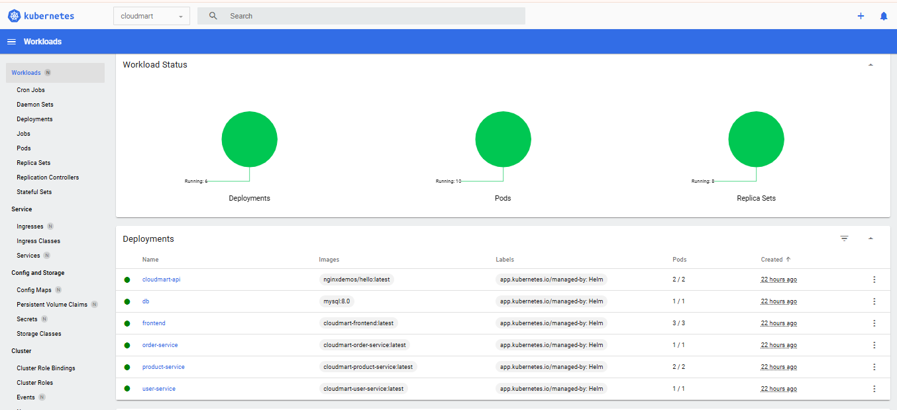
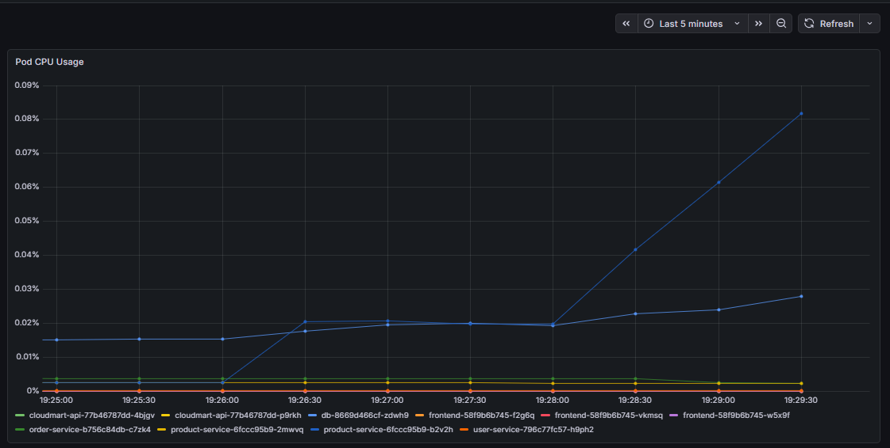
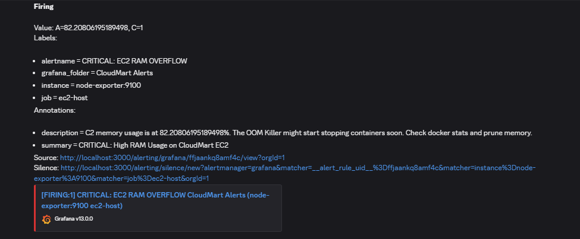
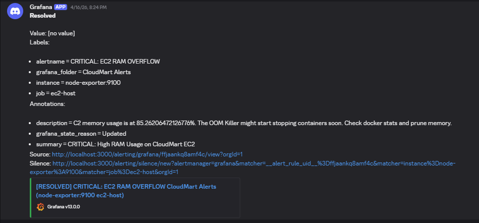

# CloudMart: Cloud Infrastructure Platform

CloudMart is a microservices e-commerce backend that takes one codebase from a local Docker Compose stack to Kubernetes and AWS. Terraform provisions the AWS environment (VPC, RDS MySQL, ECR, EC2), Kubernetes and Helm manifests run the services as replicated pods, and a staged GitHub Actions pipeline validates the infrastructure code, runs an integration smoke test, then builds, pushes and deploys the images.

## Tech Stack


- **Services:** Python 3.9 / Flask microservices (`product-service`, `user-service`, `order-service`), an nginx static frontend, and MySQL 8.0
- **Containers & orchestration:** Docker, Docker Compose, Kubernetes manifests (`k8s/`), and a Helm chart (`cloudmart-chart/`)
- **Infrastructure as Code:** Terraform with the `hashicorp/aws ~> 5.0` provider (`terraform-docs/`)
- **Cloud:** AWS VPC, subnets, IGW, security groups, IAM, EC2, RDS (MySQL 8.0), ECR
- **CI/CD:** GitHub Actions (`.github/workflows/ci.yml`, `.github/workflows/deploy.yml`), kubeconform, Helm lint
- **Observability:** Prometheus (`monitoring/prometheus.yml`), `prometheus-flask-exporter`, Node Exporter, Grafana alerts to Discord

## Key Engineering Features

- **AWS network and database defined in Terraform.** One Terraform config builds a `10.0.0.0/16` VPC with a public subnet, an internet gateway and route table, and two private subnets in `eu-north-1a` / `eu-north-1b`. A private, non-public **RDS MySQL 8.0** instance sits in a DB subnet group across both AZs, and only the web security group can reach port 3306.
- **Container registry and least-privilege compute.** Terraform creates three **ECR** repositories and an Ubuntu 22.04 **EC2** host (looked up dynamically by AMI) that bootstraps Docker through `user_data`. An IAM instance profile with `AmazonEC2ContainerRegistryReadOnly` lets the host pull images without static keys.
- **Kubernetes microservices with resource limits.** Each service runs as its own Deployment + Service in the `cloudmart` namespace, and the DB password comes from a Kubernetes Secret. The Helm chart moves replica counts (frontend 3, services 2) and CPU/memory requests and limits into `values.yaml`.
- **Multi-stage CI/CD pipeline.** `deploy.yml` runs four stages on every push to `main`, each gated on the one before it. 1) **Validate**: `terraform fmt`/`validate`, `helm lint`, kubeconform schema checks on the K8s manifests and the rendered chart, and `docker compose config`. 2) **Integration**: build every image, start the stack, and run `scripts/smoke_test.sh` against the live APIs. 3) **Build & push**: frontend, product and order images to ECR. 4) **Deploy**: over SSH to EC2, pull the new images, replace the containers, and prune old images. Pull requests run stages 1–2 through the reusable `ci.yml`.

## Architecture & Workflow



```
 Developer ── git push main ──► GitHub Actions (.github/workflows/deploy.yml)
                                  1. validate      terraform fmt/validate · helm lint · kubeconform · compose config
                                  2. integration   docker compose up --build · scripts/smoke_test.sh
                                  3. build-and-push  frontend / product / order images  ──► ECR
                                  4. deploy        SSH to EC2: docker pull, replace containers, prune
            pull request ──► ci.yml (stages 1-2 only)
                                                │
 AWS (Terraform, eu-north-1)
 └─ VPC 10.0.0.0/16
     ├─ public subnet 10.0.1.0/24
     │    └─ EC2 t3.micro (Docker, IAM role: ECR read-only)
     │         frontend :3000 · product-service :5001 · order-service :8080
     └─ private subnets 10.0.2.0/24 (1a) + 10.0.3.0/24 (1b)
          └─ RDS MySQL 8.0 :3306 (reachable from web security group only)

 Request path (local / Kubernetes):
   Browser ─► frontend (nginx, static index.html)
                ├─► product-service :5001  GET /products, /products/<id>, /health, /metrics
                ├─► user-service    :5000  POST /register, POST /login, GET /health
                └─► order-service   :5002  POST /orders, GET /health
                          └──────────────► MySQL "cloudmart" (products, users, orders)
   Prometheus ─► product-service:5001/metrics, node-exporter:9100
```

```
├── product-service/ user-service/ order-service/   # Flask microservices + Dockerfiles
├── frontend/                                       # nginx + static index.html
├── database/init.sql                               # schema + seed data
├── docker-compose.yml                              # local stack
├── k8s/                                            # raw Kubernetes manifests (namespace: cloudmart)
├── cloudmart-chart/                                # Helm chart (values.yaml: replicas, resources)
├── terraform-docs/                                 # Terraform: VPC, EC2, IAM, ECR, RDS
├── monitoring/prometheus.yml                       # Prometheus scrape config
├── scripts/smoke_test.sh                           # end-to-end API smoke test
└── .github/workflows/                              # ci.yml (validate + integration), deploy.yml (full pipeline)
```

## How to Run / Quickstart

### 1. Local stack with Docker Compose

```bash
git clone https://github.com/Danial-Umer710/CloudMart-DevOps.git
cd CloudMart-DevOps
docker compose up -d --build
```

| Service | URL |
|---|---|
| Frontend | http://localhost:8080 |
| User service | http://localhost:5000 |
| Product service | http://localhost:5001 |
| Order service | http://localhost:5002 |
| MySQL | `localhost:3307` (root / `rootpassword`, local dev only) |

The DB credentials are set as environment variables in `docker-compose.yml` (`DB_HOST`, `DB_USER`, `DB_PASSWORD`, `DB_NAME`; the order service reads `DB_DATABASE`). `database/init.sql` creates the schema and seed products on first start. Stop with `docker compose down -v`.

### 2. Kubernetes on Minikube

```bash
minikube start
for s in frontend product-service user-service order-service; do
  docker build -t cloudmart-$s:latest ./$s
  minikube image load cloudmart-$s:latest          # manifests use imagePullPolicy: Never
done

kubectl create namespace cloudmart
kubectl -n cloudmart create secret generic mysql-secrets --from-literal=ROOT_PASSWORD=<choose-a-password>
kubectl apply -f k8s/
kubectl -n cloudmart wait --for=condition=available deploy --all --timeout=180s
kubectl -n cloudmart exec -i deploy/db -- mysql -uroot -p<choose-a-password> < database/init.sql

kubectl -n cloudmart get pods,svc
kubectl -n cloudmart port-forward svc/product-service 5001:5001
```

Or install the same services with the Helm chart instead. Replica counts, resources and the DB password come from `values.yaml`. Use one path or the other, not both: each exposes `cloudmart-api-service` on NodePort 30007.

```bash
helm install cloudmart cloudmart-chart -n cloudmart-helm --create-namespace \
  --set database.password=<choose-a-password> --wait
kubectl -n cloudmart-helm exec -i deploy/db -- mysql -uroot -p<choose-a-password> < database/init.sql
```

### 3. AWS infrastructure with Terraform

Prerequisites: AWS credentials in your environment (`AWS_ACCESS_KEY_ID`, `AWS_SECRET_ACCESS_KEY`), and an EC2 key pair named `cloudmart-final-key` in `eu-north-1`.

```bash
cd terraform-docs
export TF_VAR_db_password='<strong-rds-password>'   # RDS master password, never committed
terraform init
terraform plan
terraform apply            # outputs: server_public_ip, rds_endpoint
terraform destroy          # tear down when finished
```

### 4. CI/CD configuration

The validation and integration stages need no configuration. The AWS stages (build-and-push, deploy) run only when the repository variable `DEPLOY_TO_AWS` is `true`, so the pipeline stays green after `terraform destroy`. To deploy, set that variable and these repository secrets: `AWS_ACCESS_KEY_ID`, `AWS_SECRET_ACCESS_KEY`, `AWS_REGION`, `EC2_PUBLIC_IP`, `SSH_PRIVATE_KEY`, `DB_HOST` (the `rds_endpoint` output), `DB_USER`, `DB_PASSWORD`.

## Testing & Verification

**Static checks** (no AWS account needed; the same checks run in CI's validate stage):

```bash
docker compose config -q && echo "compose OK"
(cd terraform-docs && terraform fmt -check -recursive && terraform init -backend=false && terraform validate)
helm lint cloudmart-chart
kubeconform -strict -summary k8s/*.yaml
```

```
compose OK
Success! The configuration is valid.
1 chart(s) linted, 0 chart(s) failed
Summary: 13 resources found in 8 files - Valid: 13, Invalid: 0, Errors: 0, Skipped: 0
```

**Integration smoke test** (`scripts/smoke_test.sh`, also CI's integration stage). It waits for the stack, then exercises every service end to end:

```bash
docker compose up -d --build
./scripts/smoke_test.sh
docker compose down -v
```

```
PASS  product-service GET /products   -> 8 products
PASS  user-service POST /register     -> smoke-1793899344@example.com
PASS  user-service POST /login        -> user_id=1
PASS  order-service POST /orders      -> order_id=1
PASS  frontend GET /                  -> HTTP 200
PASS  product-service GET /metrics    -> Prometheus metrics exposed
SMOKE TEST PASSED
```

**Kubernetes:** `kubectl -n cloudmart get pods` should show `db`, `frontend`, `product-service`, `user-service`, `order-service` and two `cloudmart-api` replicas as `1/1 Running`.

**Results from the deployed environment:**

| Terraform plan | GitHub Actions pipeline | K8s workload status |
| :--- | :--- | :--- |
|  |  |  |

| Load-test CPU spike | Grafana alert fired to Discord | Alert resolved |
| :--- | :--- | :--- |
|  |  |  |

The load test used Apache Benchmark (`ab`). Grafana sent a Discord alert when the CPU threshold was breached, and the alert resolved once the load stopped.
